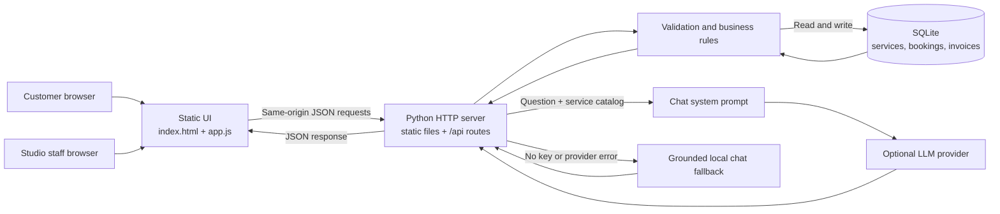

# Aura Salon & Studio — Mini Salon Booking & Billing System

A responsive salon booking app with a persistent SQLite database, REST API, availability checking, reschedule/cancel flow, admin appointment diary, invoices, and an embedded multilingual assistant. Built to cover the GURU AI Technologies Prompt Engineer hiring task.

## Requirements

- Python 3.10+ (standard library only; no `pip install` required)
- Modern browser
- Optional: an LLM API key for live provider responses

## Run locally

```bash
python server.py
```

Open **http://127.0.0.1:8000**. The database `salon.db` is created on first run. Service seeding is idempotent and creates the five required services plus three sample bookings once. The app stores future bookings and invoices in SQLite, so refreshing/restarting the server does not clear data.

## How the app works

The app has three local parts and one optional external service:

- **Browser UI:** `static/index.html`, `static/styles.css`, and `static/app.js`. JavaScript loads services, asks for available times, submits bookings, and renders customer and admin screens.
- **Python server:** `server.py` serves the UI and handles JSON requests under `/api`. It validates input and owns business rules; the browser never connects directly to the database.
- **SQLite database:** `salon.db` stores services, bookings, invoices, and invoice line items. Set `DATABASE_PATH` to move it. The database is created and seeded when the server starts.
- **Optional AI provider:** The server can send chat messages, the system prompt, and the current service catalog to an OpenAI-compatible provider or Gemini. Without a configured API key, it uses a deterministic local response instead.

### Startup sequence

1. `server.py` reads environment settings and creates the database directory if needed.
2. `init_db()` creates missing tables and an index, inserts missing services, and adds three sample bookings only when there are no bookings yet.
3. The server starts on `HOST` and `PORT` (default `127.0.0.1:8000`) and serves files from `static/` and JSON API routes from the same origin.
4. `app.js` initializes the date fields and loads the service catalog with `GET /api/services`. Selecting a service and date triggers a live availability request.

### System and data flow



All prices and booking rules are checked on the server. A browser response is only shown as successful after the API returns; failed validation or a slot conflict returns an error for the UI to display.

### Customer booking flow

```mermaid
sequenceDiagram
    actor Customer
    participant UI as Browser UI
    participant API as server.py
    participant DB as SQLite
    Customer->>UI: Choose service and date
    UI->>API: GET /api/services
    API->>DB: Read service names, prices, durations
    DB-->>API: Service catalog
    API-->>UI: Service catalog JSON
    UI->>API: GET /api/availability?date=...&serviceId=...
    API->>DB: Read active bookings for that date
    DB-->>API: Pending and Confirmed appointments
    API-->>UI: Available 15-minute start times
    Customer->>UI: Enter name, phone, and choose a time
    UI->>API: POST /api/bookings
    API->>API: Validate fields, future date, hours, and slot interval
    API->>DB: BEGIN IMMEDIATE; recheck conflicts; insert Pending booking
    DB-->>API: New booking reference
    API-->>UI: Booking details and reference
    UI-->>Customer: Show Pending confirmation
```

Availability is advisory: another booking could take a slot before submission. The server rechecks overlap inside a SQLite write transaction and returns HTTP `409` if the time was taken. Appointment duration comes from the selected service, and an appointment must finish by 8 PM.

### Other user flows

**Find, reschedule, or cancel a booking**

1. The customer enters the booking reference and the same 10-digit phone number used for booking.
2. `GET /api/bookings/{id}/public?phone=...` returns the booking only when both values match.
3. Pending or Confirmed bookings can be rescheduled or cancelled. Rescheduling fetches available times while excluding that booking, then rechecks conflicts on the server before saving. Cancellation changes its status to `Cancelled`.
4. Done and Cancelled bookings cannot be changed through the customer flow. Cancelled and Done bookings no longer block a slot.

**Manage appointments (studio staff)**

1. Staff enters the password; `POST /api/admin/login` verifies it.
2. The browser keeps the password in page memory and sends it in the `X-Admin-Password` header on each protected request. No server-side login session is created.
3. `GET /api/bookings` returns bookings, optionally filtered by date, status, or customer name/phone.
4. `PATCH /api/bookings/{id}` allows Pending to become Confirmed or Cancelled, and Confirmed to become Done or Cancelled. Done and Cancelled are terminal.

**Create and print an invoice**

1. Staff selects a customer and optional linked booking, then chooses service IDs and quantities.
2. `POST /api/invoices` verifies staff access and customer fields. It looks up each service price in SQLite; it does not trust prices sent by the browser.
3. The server saves an invoice and line-item snapshots in one transaction, then returns the invoice number and totals.
4. The UI displays the saved invoice and opens the browser print dialog. `GET /api/invoices/{id}` retrieves a saved invoice for authorized staff.

**Ask the salon assistant**

1. The chat widget sends the message to `POST /api/chat`.
2. The server reads the current service catalog. With `LLM_API_KEY`, it combines that trusted catalog with `prompts/salon-chatbot-system-prompt.txt` and calls the configured provider.
3. With no key, or if the provider fails, the server uses `grounded_reply()` for supported service, price, and hours questions.
4. The assistant does not inspect bookings or determine live availability; the booking form is the source of truth for open times.

### What is stored

| Table | Purpose |
| --- | --- |
| `services` | Service name, price, and appointment duration. |
| `bookings` | Customer name and phone, service, date/time, status, and timestamps. |
| `invoices` | Invoice number, customer, optional booking link, totals, and creation time. |
| `invoice_items` | Per-invoice service name and price snapshots, quantity, and line total. |

The database is local persistent state and is excluded from Git. A new copy gets the service catalog and sample bookings on its first run; an existing database is not reseeded with sample bookings once it has any bookings.

### Demo admin login

- Password: `AuraDemo2026!`
- Change it before sharing/deployment by setting `ADMIN_PASSWORD` in your environment.

For PowerShell:

```powershell
$env:ADMIN_PASSWORD="choose-a-strong-demo-password"
python server.py
```

For macOS/Linux:

```bash
ADMIN_PASSWORD='choose-a-strong-demo-password' python server.py
```

This evaluation build uses a shared demo password, not production-grade identity management. Use HTTPS and proper authentication/authorization before any real business use.

## Optional LLM setup

The chatbot works without an API key using a deterministic, database-grounded fallback. To use an OpenAI-compatible API:

```bash
LLM_PROVIDER=openai
LLM_API_KEY=your_key
LLM_MODEL=gpt-4o-mini
```

For Gemini, set `LLM_PROVIDER=gemini` and `LLM_API_KEY=your_key`. Environment variables must be set in the server environment; never add keys to `static/app.js`, HTML, or Git. If no provider key is configured, chat responses report grounded fallback mode internally and the UI continues to work.

## Business rules

- Service catalog (INR): Haircut ₹200 / 30 min; Beard Trim ₹100 / 15 min; Hair Spa ₹800 / 45 min; Facial ₹500 / 40 min; Bridal Makeup ₹5,000 / 120 min.
- Salon hours: 10:00 AM–8:00 PM, 15-minute start intervals. An appointment must finish by closing.
- Phone number: 10 digits.
- Pending and Confirmed bookings block overlapping times. Cancelled and Done bookings do not block future availability.
- Booking creation uses a database write lock/transaction and rechecks overlap on the server. A conflict returns HTTP 409.
- Booking reference + matching phone are required for customer lookup, rescheduling, and cancellation.
- Admin status transitions: Pending → Confirmed or Cancelled; Confirmed → Done or Cancelled. Terminal states cannot be changed through the admin status endpoint.
- Invoice prices are resolved server-side from the service catalog; browser-supplied prices are not accepted.

## API overview

| Endpoint | Purpose | Access |
| --- | --- | --- |
| `GET /api/health` | Health check. | Public |
| `GET /api/services` | Read the service catalog. | Public |
| `GET /api/availability` | Return open start times for a service/date. | Public |
| `POST /api/bookings` | Create a Pending appointment. | Public |
| `GET /api/bookings/{id}/public` | Look up a booking with its phone number. | Customer reference + phone |
| `POST /api/bookings/{id}/reschedule` | Change an eligible booking time. | Customer reference + phone |
| `POST /api/bookings/{id}/cancel` | Cancel an eligible booking. | Customer reference + phone |
| `POST /api/admin/login` | Verify the studio password. | Password required |
| `GET /api/bookings` | List/filter appointments. | Admin header required |
| `PATCH /api/bookings/{id}` | Change booking status. | Admin header required |
| `POST /api/invoices` | Create an invoice. | Admin header required |
| `GET /api/invoices/{id}` | Read a saved invoice. | Admin header required |
| `POST /api/chat` | Get a salon assistant response. | Public |

## Tests

Run:

```bash
python -m unittest discover -s tests -v
```

The test suite uses a temporary database and covers seeded services, slot overlap, server-side validation, booking persistence/conflicts, status transitions, chatbot grounding/refusal, and prompt-file presence. No external LLM credentials are needed for the tests.

## Deploying

This app can run on any host that supports a persistent Python process and writable disk. Set `PORT` if the host provides it. For a small evaluation deployment, attach persistent disk storage and set `DATABASE_PATH` to that mounted location. Do not deploy to a purely static host: the API and SQLite database require a running backend. SQLite on ephemeral serverless filesystems will lose data; use persistent disk or migrate the schema to a hosted PostgreSQL database before using such a platform. Set `ADMIN_PASSWORD`, enable HTTPS, and configure `FRONTEND_ORIGIN` for the deployment domain.

The source is published at [github.com/pradeep231790/mini-salon-booking-billing](https://github.com/pradeep231790/mini-salon-booking-billing). This repository does not include a hosted app URL or a screen recording; those require a separate deployment and recording.

## Submission checklist

- [x] Publish repository and share link/access with evaluator.
- [ ] Deploy backend with persistent storage and test the public live URL.
- [ ] Configure `ADMIN_PASSWORD` and optional LLM key as server environment variables.
- [ ] Test booking, occupied-slot rejection, rescheduling, cancellation, admin status changes, invoices, and chatbot on deployed version.
- [ ] Record a 2–3 minute walkthrough (booking → admin → billing → chatbot) and explain one technical decision in your own words.
- [ ] Submit `prompts/salon-chatbot-system-prompt.txt` and `docs/prompt-iteration-note.md`.

## Project structure

```text
mini-salon/
├── server.py                         # HTTP routes, validation, SQLite, chat
├── static/
│   ├── index.html                    # Customer, chat, and studio UI
│   ├── app.js                        # UI state and API requests
│   └── styles.css                    # Responsive presentation
├── database/README.md                # Database initialization notes
├── prompts/salon-chatbot-system-prompt.txt
├── docs/architecture.md              # Compact architecture/API reference
├── docs/prompt-iteration-note.md
└── tests/test_app.py                 # API and business-rule tests
```